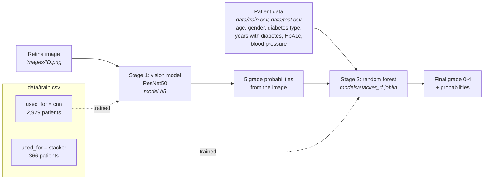

This repository contains the resources for the explainability homework.

# The Use Case: Blindness Detection 
The use case is to detect [diabetic retinopathy](https://www.nei.nih.gov/learn-about-eye-health/eye-conditions-and-diseases/diabetic-retinopathy) to stop blindness before it's too late. 

Consider you are building a smartphone app that could be used by trained users (nurses, volunteers) to perform screenings to detect potential problems simply by having patients look into the smart phone's camera through a specialized lens attachment (a small 3-d printed holder for a lens). 

Deploying such medical diagnostics as a smart phone app and low-cost hardware extension has the potential to drastically reduce screening costs and make screenings much more available, especially in underresourced regions of the world. Instead of having to walk to a clinic with specialized equipment, trained users could perform screenings at mobile clinics or in patients homes. The app would provide information about a potential risk and encourage the patients to get in contact with medical professionals for more accurate testing and potential treatment. 

In this assignment, you will focus on the model, but also consider its integration into a smartphone app and its use for screening by trained users in underresourced regions (e.g., remote areas, high-poverty areas).


# Data

The retina images were taken using fundus photography under a variety of imaging conditions.
A clinician has rated each image for the severity of diabetic retinopathy on a scale of 0 to 4:

```
0 - No DR
1 - Mild
2 - Moderate
3 - Severe
4 - Proliferative DR
```

Like any real-world data set, you will encounter noise in both the images and labels.
The images come from a [Kaggle competition](https://www.kaggle.com/c/aptos2019-blindness-detection/overview).

For each patient, `data/train.csv` and `data/test.csv` contain the clinician's rating and patient data collected during the screening: age, gender, diabetes type (1 or 2), years since the diabetes diagnosis, HbA1c (average blood sugar over the last three months, in percent), and systolic blood pressure. The patient id is also the file name of the retina image. The original dataset does not include patient data; this data is simulated for this assignment.

The column `used_for` says which model was trained on each patient: `cnn` patients trained the vision model, `stacker` patients trained the random forest, and `test` patients were used for neither.

# Model

The model has two stages:

1. A `ResNet50` vision model (`model.h5`) grades the retina image and outputs a probability for each of the five grades.
2. A random forest (`models/stacker_rf.joblib`) combines these five probabilities with the patient data into the final grade.



The 367 patients in `data/test.csv` were used to train neither model.

We strongly suggest you use the provided models, but you can also train your own or use different models.

The vision model and the images are available in this [Google Drive folder](https://drive.google.com/drive/folders/1X_tTwEixtZdkVWrCae3LK7maP6m2wF4T?usp=drive_link). Place `model.h5` and the `images` folder (in `data/images` on Drive) in the root of this repository, so that images are at `images/ID.png` (or adjust the paths in the notebooks).

# Code

`retinopathy_model.py` loads and runs both stages:

```python
from retinopathy_model import RetinopathyModel, load_image, load_patient

model = RetinopathyModel("model.h5", "models/stacker_rf.joblib")
patient = load_patient("281d7b7c7676")             # patient data by id
image = load_image(f"images/{patient.id_code}.png")
prediction = model.predict(image, patient)
print(prediction.grade_name)                       # final grade
print(prediction.probabilities)                    # final probabilities for grades 0-4
print(prediction.cnn_probabilities)                # probabilities from the image alone
```

The template notebook `template_code_for_explanation_and_html.ipynb` shows how to load the models, make a prediction for a patient, and fill an HTML template. This is the kind of code that would be integrated into the smartphone app, either locally or as a remotely deployed model inference service. You can use, extend, and modify the notebook, create your own, or work outside of notebooks -- whichever you prefer.

For reference, the repository also contains the notebooks that trained the models. *You do not need to run them*:

* `diabetic-retinopathy-training.ipynb` trained the vision model (written for TensorFlow 2.15 and Keras 2; it does not run unchanged with current versions).
* `stacker-training.ipynb` trains the random forest and compares it with the vision model alone. If loading `models/stacker_rf.joblib` fails because of a different scikit-learn version, rerun this notebook to retrain the random forest.

# Setup

The code requires Python 3.12 or 3.13. With [uv](https://docs.astral.sh/uv/):

```bash
uv sync
uv run jupyter lab
```

Alternatively, install the dependencies listed in `pyproject.toml` with pip. On Google Colab, the required packages are preinstalled; clone your repository so that `retinopathy_model.py`, `data/`, and `models/` are available, and copy `model.h5` and `images` from Google Drive.
